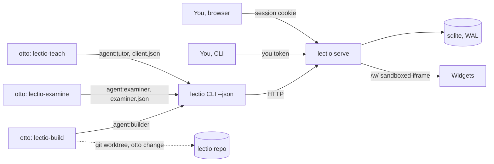

# lectio — architecture

Last checked against: `dee45e8` on 2026-11-13

## Purpose and boundaries

A personal tutor for one learner per instance: the app keeps the subjects, lessons, quizzes and
the gradebook, schedules reviews per concept with FSRS, and enforces who may do what. Three
skills run by otto do all the judgement: a tutor teaches, an examiner writes independent
checkups, and a builder builds the approved proposals to improve lectio itself.

**Out of scope:** AI inside the app (no model SDK in `package.json`); more than one learner per
instance; the app changing its own code (the builder works in a git worktree and hands back an
otto change; you ship it). The design record is `PLAN.md`.

## Components and data flow



| Component | Where | Does |
|---|---|---|
| CLI | `src/cli.ts`, `src/commands/`, `src/client.ts` | `serve`, `service`, `token`, `login` and the local checks run locally; the rest are HTTP calls |
| Local checks | `src/local/` | `figure check`, `widget check`, `tools` run where the tutor runs (headless Chrome if present) |
| Server | `src/server/server.ts` | Bun.serve: web bundle, the JSON API, event stream, assets, widget documents |
| Request guard | `src/server/hostCheck.ts` | Host/Origin check before any route |
| API router | `src/server/api.ts`, `src/server/routes/` | Each route names the roles that may call it; the router refuses the rest |
| Roles | `src/core/permissions.ts` | `agent:builder` is the builder, `agent:examiner` the examiner, any other agent the tutor, `you` the learner |
| Background | `src/server/background.ts` | Hourly: daily backup, expire checkups that waited too long |
| Data layer | `src/db/` | Schema, migrations, auth, lessons, quizzes, memory, exams, proposals, events |
| Pure core | `src/core/` | Validation, schedule, FSRS wrapper (`src/core/memory.ts`, `ts-fsrs` pinned), measures, errors |
| Blocks and questions | `src/blocks/`, `src/questions/` | One module per lesson block type and question type |
| Widget sandbox | `src/server/widgets.ts`, `src/core/widget.ts` | Serves widgets under a CSP sandbox: opaque origin, no network |
| Web app | `src/web/` | React 19, bundled by Bun from `src/web/index.html` |
| Service | `src/local/service.ts` | launchd agent per instance (macOS) |
| Skills | `skills/lectio-teach/`, `skills/lectio-examine/`, `skills/lectio-build/` | Each has a SKILL.md and a check.sh that wakes it only when there is work |
| Migration check | `scripts/check-migrations.ts` | Runs this checkout's migrations on a copy of your newest backup |

## Where state lives

| State | Where | Survives a crash? | Backed up? |
|---|---|---|---|
| The database (subjects, lessons, attempts, memory, checkups, proposals, tokens, sessions, settings, events) | lectio.db in the data directory (`--dir`, else LECTIO_DIR, else ~/.lectio; `src/config.ts`) | yes: WAL, busy timeout 5 s | daily VACUUM INTO backups/, newest 14 kept (`src/db/backup.ts`) |
| Uploaded assets | assets/ in the data directory, by sha256 | yes: immutable files | copied once into the backups (`src/db/backup.ts`) |
| CLI tokens | client.json (you, tutor, builder); examiner.json (examiner only) (`src/client.ts`) | n/a | no |
| Server log (service only) | logs/ in the data directory | n/a | no |

Migrations are an append-only numbered list in `src/db/database.ts`, each run in its own
transaction and recorded in PRAGMA user_version; there are no down migrations. A bad one is
caught three ways: before migrating an existing database the server takes a
`pre-migration-v<n>` backup; `bun run check:migrations` runs the new migrations on a copy of
your newest backup and fails if a table or rows vanish, integrity or foreign keys break, or the
API stops answering. A database at a higher version than the code knows is refused before any write (exit 4), so an older build never runs on a newer schema. Undoing one means `lectio backup restore <file>`, which keeps the replaced db.

## Trust boundaries

Auth is attribution (`src/db/auth.ts`): a token names an actor; its role decides what the server allows.

| Actor | Gets in by | Can | Can't |
|---|---|---|---|
| You (learner) | `you` token, or a session cookie traded for one in the browser | everything that is the learner's: answer, grade free responses, react, approve/decline/ship proposals, settings | the agents' writes (submit lessons, checkups, claim builds) |
| Tutor (`agent:*`) | its token in client.json | open runs, write lessons and quizzes, fix flagged blocks, reply, file proposals, judge shipped ones | write attempts, approve or ship proposals, sign in to the web app, see any checkup before it's finished |
| Examiner (`agent:examiner`) | its own examiner.json or LECTIO_TOKEN | read its own routes (syllabus, objectives, drawn concepts); write checkups, its runs, fixes and replies on its checkups | read lessons or the tutor's data |
| Builder (`agent:builder`) | its token | read everything but checkups; claim, ask about and submit proposals | write lessons, quizzes, notes, grades, replies or assets; approve its own work |
| Anyone with shell access as you | `lectio token <actor>` opens the database directly | issue any token | (outside the model) |
| The network | binds 127.0.0.1 unless listen_host is set; Host must be loopback with our port or in allowed_hosts; writes with a foreign Origin get 403 | reach the API only with a token or cookie | DNS-rebind it |

Secrets on disk: tokens in the database and in client.json/examiner.json. Data directory and
backups 0700, database, -wal, -shm, backups and client.json 0600; token files are written 0600;
`lectio serve` tightens looser ones on start (`src/db/fileModes.ts`). The set it tightens does
not include examiner.json, assets/ or logs/.

## Invariants

| # | Invariant | Enforced by |
|---|---|---|
| I1 | Every write route names who may make it | `tests/guard/permissions.test.ts`: "every write names who may make it" |
| I2 | No agent writes attempts, creates feedback, or approves, declines or ships a proposal | `tests/guard/permissions.test.ts`: "no agent writes attempts, creates feedback, or approves, declines or ships a proposal" |
| I3 | Every learner-only command is refused for an agent with exit 2 | `tests/e2e/m2-quizzes.test.ts`: "every learner-only command is refused for an agent with exit 2, and says whose it is" |
| I4 | Only a `you` token signs in to the web app | `tests/e2e/m3-web.test.ts`: "a browser signs in with a you token and gets a session cookie; agent tokens are refused" |
| I5 | The tutor and builder see nothing of an open checkup | `tests/guard/exam-isolation.test.ts`: "while a checkup is open, no GET and no event shows the tutor or the builder anything of it" |
| I6 | The examiner sees the syllabus and objectives, never the lessons | `tests/e2e/m12-examiner.test.ts`: "the app draws the concepts; the examiner sees the syllabus and objectives, not the lessons, and must cover every drawn concept" |
| I7 | The examiner writes only checkups, its runs, fixes to its own questions, and replies on its checkups | `tests/guard/permissions.test.ts`: "the examiner writes only checkups, its runs, fixes to its own questions, and replies on its checkups" |
| I8 | Only the builder claims and submits; only the tutor judges outcomes | `tests/guard/permissions.test.ts`: "only the builder claims and submits; only the tutor reviews builds and judges outcomes" |
| I9 | Agents can't grade themselves: widget-scored attempts stay out of the measures | `tests/e2e/r5-self-scored.test.ts`: "widget-scored attempts are left out of the predictions measure but still count for memory", "widget-scored attempts are left out of the experiment-arm measures" |
| I10 | The examiner's token lives apart from the tutor's | `tests/e2e/r5-agent-tokens.test.ts`: "the examiner's token goes to its own file, not beside the tutor's, and --as agent:examiner finds it" |
| I11 | `you` and agent tokens never share a client.json | `tests/e2e/r5-agent-tokens.test.ts`: "lectio login refuses an agent token into a client.json holding \"you\"" |
| I12 | Checkup answers leave memory and the measures unchanged | `tests/e2e/m12-examiner.test.ts`: "checkup answers leave memory, the existing measures and later reviews' gaps unchanged" |
| I13 | A foreign Host, or a write with a foreign Origin, gets 403 before any route | `tests/e2e/r2-host-origin.test.ts`: "a request for a foreign host is refused with 403, naming the host and allowed_hosts", "a POST with a foreign Origin is refused with 403" |
| I14 | With no listen_host set, the server binds 127.0.0.1 only | `tests/e2e/r2-file-modes.test.ts`: "with no listen_host set, lectio serve listens on 127.0.0.1 only" |
| I15 | Data files are private, and serve tightens looser ones | `tests/e2e/r2-file-modes.test.ts`: "a new data directory, database, -wal and -shm are created private", "after lectio serve starts on a data dir with 0644 files, the dirs are 0700 and the files 0600" |
| I16 | A widget gets no origin and no network | `tests/guard/widget-sandbox.test.ts`: "a widget is served only to someone signed in, under a sandbox that gives it no origin and no network" |
| I17 | An existing database is backed up before it is migrated | `tests/e2e/pre-migration-backup.test.ts`: "an older database is backed up, at its old version, before it is migrated" |
| I18 | One backup a day, pruned to the newest | `tests/unit/service.test.ts`: "daily backups: one a day, pruned; assets are copied once" |
| I19 | Every example in `lectio agents` runs as documented | `tests/e2e/contract.test.ts`: "every example in the contract runs as documented", "the examiner's examples run as documented" |
| I20 | Exit codes: bad usage 2, not found 3, unreachable 4 | `tests/e2e/m1-lessons.test.ts`: "unknown commands and options exit 2", "not found is exit 3", "an unreachable server exits 4, a bad token 2" |
| I21 | Migrations are append-only; a shipped one is never edited | **unenforced:** a comment in `src/db/database.ts`; `check:migrations` needs your real backup, so it isn't in `bun run test` |
| I22 | Tests never touch the real data directory | **unenforced:** the preload `tests/setup.ts` points LECTIO_DIR at a temp dir; no test asserts it |
| I23 | `src/core/` is pure | **unenforced:** a convention in `PLAN.md`; candidate for an import check |
| I24 | No AI in the app | **unenforced:** nothing stops a model SDK being added to `package.json` |
| I25 | A database newer than the code is refused (exit 4) with the file and its -wal byte-for-byte unchanged; one exactly at the code's version opens | `tests/e2e/r16-newer-database-refused.test.ts`: "a database one version newer than this build is refused, byte-for-byte unchanged, naming both versions and the backup folder", "a newer database with un-checkpointed -wal frames is refused, the main file and the -wal both byte-for-byte unchanged", "the CLI and lectio serve refuse a newer database with exit 4, and the envelope with --json", "a database exactly at this build's version opens as before" |

## Decisions

The design record is `PLAN.md` (principles, data model, contract, milestones); it isn't repeated here.

- 2026-10-20 · Start from legenda's conventions; FSRS per concept via pinned `ts-fsrs` · `PLAN.md` §2, §7
- 2026-10-24 · An examiner the tutor doesn't control (M12) · learning measured by someone who didn't teach · 3ea89ee
- 2026-10-24 · Bind 127.0.0.1, Host/Origin check, private data files (R2) · LAN and DNS-rebinding exposure · 8b3c506
- 2026-10-28 · Widgets in a CSP sandbox (M21) · agent-written code must not reach the API or network · c63fd8b
- 2026-10-31 · Separate token files; the examiner's own; widget scores out of the measures (R5) · 13ed069, 70ae18b, 81ed277
- 2026-11-05 · A pre-migration backup and `check:migrations`; a real browser harness · migrations run on real data when a change lands · 1d26351, c0f154f
- 2026-11-13 · Refuse a database newer than the code (R16), copied from legenda and omnifactum · after a rollback, old code would run on a schema it doesn't know · dee45e8

## Family

Follows legenda's map except (shared design: `~/workspace/architect/FAMILY.md`):

- Three skills with distinct roles and tokens (tutor, examiner, builder; `src/core/permissions.ts`); the examiner never sees the lessons, the tutor never an open checkup.
- lectio improves itself: proposals filed by the tutor, approved by you, built by `lectio-build`, judged by the tutor after they ship.
- Agent-written widgets run in a sandbox; FSRS memory per concept; no polled sources.
- Migrations get a pre-migration backup and a check on your real backup.
- A Playwright browser harness (`tests/browser/`) on top of the shared test layout.

## How to verify a change

Rung 3 on the verifiability ladder (`~/workspace/architect/VISION.md`), re-checked at `fdbba03`.
Rung 2: `tests/browser/instance.ts` starts a real server on a free port against a temp database
with seeded data (`tests/browser/seeds.ts`), and Playwright drives it in WebKit and Chromium at
phone, tablet and desktop sizes. Rung 3 for screens: the same run writes every page at every
size to .playwright/gallery/ (gitignored, made by the run) and compares five pages to saved pictures in
`tests/browser/looks/`. Not rung 4: the builder attaches pictures by hand, and nothing produces
CLI transcripts as evidence.

```bash
bun install --frozen-lockfile
bun run test               # typecheck + bun test + Playwright
bun run check:migrations   # a change with a migration: runs it on a copy of your newest backup
```

## Unverified

- The user's running instance: listen_host, allowed_hosts, port, and how the three skills' otto runs are set up.
- The skills' behaviour in real otto runs (`bun run test:live` exists but spends a real tutor; not run here).
- `check:migrations` and `test:real` against real data (they read ~/.lectio; not run here).
- That examiner.json is always created 0600 (written with mode 0600; not in the tightened set).
