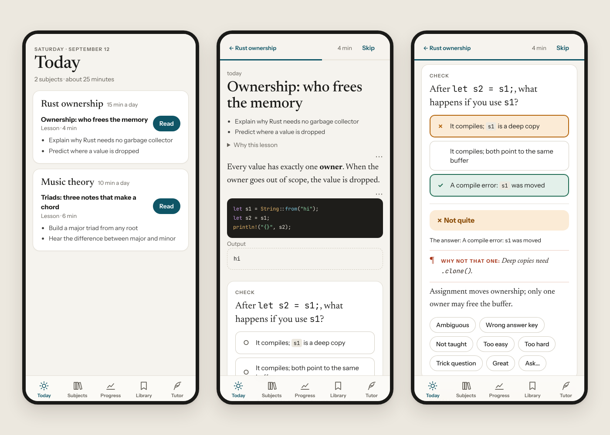

<p align="center">
  
</p>

# lectio

*Lectio*: Latin for "a reading". The word "lesson" comes from it.

A personal tutor that teaches you something every day. You give it subjects ("Rust", "music
theory", "the AWS Solutions Architect exam"), each with what you want to get out of it. Every day
an AI tutor (a Claude Code skill, run by [otto](https://github.com/thejosh00/otto)) writes you a
lesson and a quiz for each one. It decides what you should learn next, explains it the way that
has worked for you before, and brings back what you are about to forget.

The app contains no AI. It stores subjects, lessons and questions, renders them, grades what can
be graded mechanically, schedules reviews with a formula (FSRS, per concept), and records every
answer in enough detail for the tutor to see what works: right or wrong, how sure you were, how
long it took, whether you used a hint, and which wrong idea you picked. The judgement lives in the
skill.

<p align="center">
  <picture>
    <source media="(prefers-color-scheme: dark)" srcset="docs/screenshot-dark.png">
    
  </picture>
</p>

## Install

Needs [Bun](https://bun.sh) 1.4+.

```bash
./install.sh        # bun install + bun link: puts `lectio` on your PATH (~/.bun/bin)
```

To update: pull, `./install.sh`, then `lectio service restart` (once you've installed the
service, below).

## Quick start

```bash
lectio serve                                       # the server and web app, on 127.0.0.1:7780
lectio token you                                   # a token for you (in another terminal)
lectio login --url http://127.0.0.1:7780 --token <it>
lectio subject add "Rust" --goal "read and change our Rust services" --minutes 15
```

Open `http://localhost:7780` and sign in with the same `you` token.

The server listens on this machine only (`127.0.0.1`) and answers only to `localhost`,
`127.0.0.1` and `[::1]`; any other `Host`, and any write whose `Origin` is not one of those,
gets a 403. That keeps web pages (DNS rebinding) and other devices out. To use it from a phone,
open it to the network and name the host the phone will use:

```bash
lectio settings set listen_host 0.0.0.0
lectio settings set allowed_hosts your-mac.local    # comma-separated; an IP works too
```

Restart the server for `listen_host`; `allowed_hosts` applies at once. Then, once, open
`http://your-mac.local:7780/?token=<it>` on the phone; the token is traded for a cookie and
removed from the address bar. The web app is made for a phone first; add it to your home screen.

The data directory and its backups are `0700`, and the database, its `-wal`/`-shm`, the backups
and `client.json` are `0600`; `lectio serve` tightens any it finds looser.

To keep it running in the background (macOS), with a daily backup into `$LECTIO_DIR/backups`:

```bash
lectio service install             # [--port N] [--host H]
lectio service status | logs | restart | stop | uninstall
```

`LECTIO_DIR` (default `~/.lectio`) holds an instance's database, its uploaded files, its
`client.json` and its backups. Instances share nothing, so a second one is a second directory and
port. `lectio settings` lists every setting; `listen_host 0.0.0.0` with `allowed_hosts` opens it to your
network.

## A day with lectio

```bash
lectio today                     # what is waiting: lessons, quizzes, reviews, replies
lectio lesson                    # read today's lesson in the terminal (or open the web app)
lectio finish <lesson> --rate clear
lectio quiz                      # take the quiz: answer, then s/t/g for how sure you were
lectio practice                  # reviews that are due, now
lectio rate block <id> wrong --note "…"   |   lectio ask <block> "…"   |   lectio dispute <attempt>
lectio progress                  # retention, same-day accuracy, calibration, what's working
lectio notes [--history]         # what the tutor believes about how you learn; `notes edit` to correct it
```

Ids can be shortened to a unique prefix; a subject can be named by its title. Every command takes
`--json`.

**What gets measured.** The number that matters is *retention*: whether you can still answer about
an idea a day or more after meeting it — first try, no hint, not guessing. Same-day accuracy is the
difficulty dial (the tutor aims at 85%, not 100%). There are no streaks or points: an honest
Progress page is the motivation.

**A week away** comes back to one lesson waiting, not seven: a subject gets at most one lesson a
day, and none while an earlier one is unfinished.

## The tutor

The tutor is just another actor, with its own token. The server enforces what it may do:

- **Attributed.** Every write records its actor (`agent:tutor`) and the run that made it.
- **Capped and idempotent.** One lesson per subject per day, none before `lesson_ready_hour`, none
  while one is unfinished. Re-submitting a day returns `"existing": true` and changes nothing.
- **Refused what is yours.** An agent can't answer quizzes, give feedback, finish or skip lessons,
  change subjects or settings, or issue tokens. Those exit `2`.
- **Wrong is worse than nothing.** Flag a block as wrong in one tap; the tutor fixes flags before it
  writes anything new.

`lectio agents` prints the contract the tutor follows — setup, every command with an example, the
JSON shapes, the block and question types, exit codes and limits. It is generated from the code, and
a test runs every example in it against a real server.

| Exit | Meaning |
|---|---|
| 0 | ok |
| 1 | failed: not ready, a cap, a refused write |
| 2 | bad usage, an invalid submission, or not allowed for this actor |
| 3 | not found |
| 4 | server unreachable or busy |

### Setting it up

Install the skills for Claude Code:

```bash
ln -s "$PWD/skills/lectio-teach" ~/.claude/skills/lectio-teach
ln -s "$PWD/skills/lectio-build" ~/.claude/skills/lectio-build
```

Give the tutor a token, and let the CLI find it without environment variables (it runs unattended,
where no shell profile is loaded):

```bash
lectio token agent:tutor
lectio login --url http://127.0.0.1:7780 --token <it> --default     # writes $LECTIO_DIR/client.json
```

Try a run by hand first: in `claude`, ask it to "run the lectio tutor". Then look at the Tutor page.

## Running it under otto

```bash
otto run --skill lectio-teach \
  --goal "Each day, teach me each of my lectio subjects with a lesson and a quiz made for me, and get better at teaching me from how I do" \
  --perpetual --period 1h
otto check <run> --script "$PWD/skills/lectio-teach/check.sh"
```

- **Hourly, behind a check script.** `check.sh` runs `lectio due` and wakes the model only when
  there is something to do: a subject became ready, a new subject was added, or a flag or ask is
  waiting. Most hours cost nothing. A stopped server doesn't wake it either; otto's daily safety
  net does, and that wake reports it.
- `--perpetual`: there is no done. Retire it with `otto stop`.
- The tutor talks to you through the app (replies, notes, run summaries), not otto's inbox.
- For a non-default instance, put `LECTIO_DIR` in a copy of `check.sh`: otto launchers don't set
  environment variables.

## Checkups: an examiner the tutor doesn't control

The tutor writes the lessons and the quizzes that retention is measured on, so its numbers are
partly its own making. A third agent, the examiner, checks it: every week (`exam_days`) it writes
each subject a short checkup on concepts the app draws at random, from the syllabus alone. It never
sees a lesson, the tutor's questions, notes or memory, and the tutor sees nothing of a checkup until
you've finished it; then it gets the results. Checkup answers never count for memory and stay out
of every other measure. Progress shows how you did beside what the memory model expected, and the
gap says whether the tutor's own reviews flatter you.

The tutor can't see checkups because the server hides them from its token, not because it couldn't
find a way (it runs on your machine). Its `rules.md` forbids another token or reading the database
directly.

```bash
ln -s "$PWD/skills/lectio-examine" ~/.claude/skills/lectio-examine
lectio token agent:examiner
lectio login --url http://127.0.0.1:7780 --token <it>      # added to client.json; the tutor stays the default
otto run --skill lectio-examine \
  --goal "Write each of my lectio subjects an independent weekly checkup from the syllabus alone" \
  --perpetual --period 6h
otto check <run> --script "$PWD/skills/lectio-examine/check.sh"
```

For more independence, run the examiner on a different model from the tutor.

## Improving lectio itself

The tutor is lectio's most demanding user. When the app gets in the way of teaching, it proposes a
change. You approve it, a second agent (the builder) implements it on a branch with tests, and you
ship it like any other change. The tutor's next run sees it, checks it works, and asks for another
change if it doesn't. Once it has used the change for a while, it records whether it helped.

```bash
lectio proposals                                   # or the Improvements page (Tutor → Improvements)
lectio proposal approve <n> [--priority high]
lectio proposal decline|defer <n> --note "…"
lectio proposal answer <n> "…"                     # to a builder's question
git merge lectio/p<n>-<slug> && lectio service restart   # ship a built branch
lectio proposal request-changes <n> --note "…"     # or send it back instead
```

Run the builder against this repository, with its own token beside the tutor's:

```bash
lectio token agent:builder
lectio login --url http://127.0.0.1:7780 --token <it>     # added to client.json; the tutor stays the default
otto run --skill lectio-build --repo ~/workspace/lectio \
  --goal "Build the approved lectio improvement proposals, one at a time, and hand each back for review" \
  --perpetual --period 1h
otto check <run> --script "$PWD/skills/lectio-build/check.sh"
```

The builder works in `.work-trees/lectio-build/` on `lectio/p<n>-<slug>` branches, never in this
checkout; it never pushes, merges or deploys. It sends an otto inbox message when a branch is ready.

**Shipping.** Merge the branch into `main` and restart lectio, as you would any change. A server run
from a checkout records the commit it is running at startup and marks every built proposal whose
commit is part of it as shipped. (Squashing or rebasing gives the branch new commits, so mark those
by hand with `lectio proposal shipped <n> --commit <sha>`, as you would for a binary build.)

**The tutor checks what shipped for it.** A shipped proposal the tutor filed wakes its next run
(`lectio due`). It reads the new contract and the builder's hand-back, tries the change, and either
accepts it or asks for another change, which goes back to the builder (`lectio proposal review <n>
accept|changes`). Until then the Improvements page lists it under *With your tutor*.

**Pictures that teach.** Every picture sits on light paper in both themes, drawn from one palette,
so a colour means the same thing in every lesson; a tap enlarges it. When the tutor stores or uses a
picture, lectio warns about what a reader on a phone would notice — labels too small, a diagram too
wide, a caption doing the picture's job — and `lectio figure check <file>` shows the tutor the picture
as your phone will. A question can show the picture it asks about, and another with its answer (the
labelled diagram, the model sketch to compare yours with). When to use one is the tutor's craft (`skills/lectio-teach/teaching.md` and
`figures.md`).

**Media types are a ladder.** Images, diagrams and step-throughs exist; animations, audio and video are
added one at a time, when the tutor shows the need: ideas of one kind that keep failing however it
teaches them with what it has. Its proposal names the media type, and `lectio tools` says whether this
machine can make it (Chrome, ffmpeg, manim, `say`…; installing them is yours to do). Once shipped, the
tutor tries the new type in two-arm lessons against the best alternative, and its outcome waits for
that evidence. Progress shows, per media type, how what it taught was retained.

**Guardrails.** People sit at both ends: nothing is built until you approve it and nothing runs
until you ship it. `tests/guard/` pins what an agent's token can never do and what the measures
mean; the builder never loosens a test to make a change pass.

## Backups

The server backs up daily and keeps a fortnight. `lectio backup --label <name>` takes one on
demand; `lectio backup restore <file>` puts one back (stop the server first). Uploaded files are
copied alongside, once each.

## Development

```bash
bun run dev          # serve with hot reload
bun run test         # typecheck + the whole suite
```

Layout: `src/core/` is pure (no fs, db, clock, randomness or React). `src/blocks/` has one module
per block type and `src/questions/` one per question type, each behind its interface and listed in
a registry; the web renderers are in `src/web/blocks/`. Then `src/db/`, `src/server/`,
`src/commands/` (a thin CLI client: flags → one HTTP call), `src/web/` (React, bundled by Bun from
`index.html`), `src/local/` (launchd, git) and `skills/`.

Tests never touch the network, and the clock is injected so a test can live through a week in a
second. A preload points `LECTIO_DIR` at a temporary directory and sets a non-UTC time zone, so
"today" is tested as the local day it is.

The plan, milestones and reasoning are in [PLAN.md](PLAN.md).
